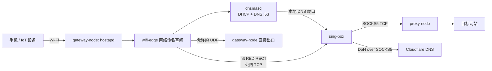

家里有一台 Linux 主机带无线网卡，我希望它提供一个独立 Wi-Fi 热点：手机连上后不需要安装客户端、不需要手动设置代理，就能通过另一台机器上的 SOCKS5 出口访问互联网。同时还要保留 IoT 设备直连、设备互访和后续精细分流的能力。

本文记录这套 `wifi-diy` 网关从 `redsocks + dnscrypt-proxy` 演进到 sing-box 的过程，并对 Squid、Mihomo、sing-box、OpenWrt 等方案进行比较。

> 本文不记录 Wi-Fi 密码、真实主机名、节点编号、内网地址或 API 密钥。文中的 IP 均来自 RFC 5737 文档专用地址段，端口和 namespace 名也是示例值，不能直接用于生产环境。

## 需求与约束

实验环境中有两个关键节点：

- `gateway-node`：带无线网卡，负责热点、DHCP、NAT 和透明代理入口；
- `proxy-node`：提供 SOCKS5 出口；
- 示例热点网段：`192.0.2.0/24`；
- 两台机器同属一个 Kubernetes 集群，代理工作负载固定运行在 `gateway-node`。

目标包括：

1. 手机连接热点后自动获得网关和 DNS；
2. 公网 TCP 透明转发到 `proxy-node` 的 SOCKS5 服务；
3. DNS 使用 Cloudflare DoH，并且 DoH 本身也通过 SOCKS5；
4. 不允许热点设备直接访问家庭局域网；
5. IoT 设备需要的部分 UDP 流量仍可直连；
6. 无线驱动异常时，热点恢复不能依赖 Kubernetes 调度；
7. 代理组件可以通过 Deployment 更新和回滚。

## 最终架构



整个系统分为宿主机层和 Pod 层。

### 宿主机层

`gateway-node` 宿主机继续负责：

- `hostapd`：管理无线网卡和 SSID；
- `dnsmasq`：分配地址、网关和 DNS；
- `wifi-edge` network namespace：隔离热点网络；
- nftables：外层防火墙、NAT 和透明重定向；
- systemd：确保无线设备、namespace、DHCP 在开机阶段按顺序恢复。

没有把无线网卡完全交给 Pod。物理无线设备、驱动恢复、RFKill 和 hostapd 对启动顺序非常敏感，这部分留在宿主机更容易诊断。

### Kubernetes 层

Kubernetes Deployment 只负责运行 sing-box：

- 单副本；
- 使用 `Recreate` 更新策略；
- 通过 `nodeSelector` 固定到 `gateway-node`；
- 挂载宿主机 `/run/netns`，进入 `wifi-edge`；
- 加载专属 nftables 表；
- 监听透明 TCP 和本地 DNS 示例端口；
- readiness/liveness probe 检查进程与监听端口。

`Recreate` 很重要。两个特权 Pod 如果同时操作同一个 network namespace、端口和 nftables 表，会产生竞争，因此不能使用默认的滚动双实例方式。

## 两条主要数据路径

### DNS

```text
手机
  → 192.0.2.1:53 dnsmasq
  → 127.0.0.1:1053 sing-box DNS inbound
  → Cloudflare DoH
  → proxy-node SOCKS5
  → 返回域名解析结果
```

DHCP 将示例地址 `192.0.2.1` 同时下发为网关和 DNS。nftables 还会把热点接口上的 UDP/53 重定向回本地 DNS，减少客户端误用普通 DNS 造成的泄漏。

sing-box 使用 `hijack-dns` 将本地 DNS 入站交给内部 DNS 模块，Cloudflare DoH 的连接通过 `proxy-upstream` 出站。因为当前 SOCKS5 没有可靠的 UDP relay，所以 DoH 使用 HTTPS/TCP。

### HTTPS 和其他 TCP

```text
手机访问公网 TCP
  → wifi-edge nftables PREROUTING
  → REDIRECT 到 sing-box 示例端口
  → sing-box redirect inbound
  → proxy-upstream SOCKS5 outbound
  → 目标网站
```

私网、保留地址和组播地址不会进入透明代理。外层防火墙默认阻止热点客户端访问家庭局域网，只显式允许访问代理节点的 SOCKS5 端口。

目前 UDP/443 会被拒绝，让浏览器从 QUIC/HTTP3 回退到 HTTPS/TCP。其他被允许的 UDP 仍保持直连，这对部分 IoT、NTP 和局域网发现协议更友好。

## 方案对比

| 方案 | 优点 | 局限 | 结论 |
| --- | --- | --- | --- |
| redsocks + dnscrypt-proxy | 组件简单，透明 TCP 和加密 DNS 容易实现 | 路由规则分散，难以按设备和域名分流，UDP 能力弱 | 适合第一版验证，不适合继续扩展 |
| Squid | HTTP ACL、访问日志、认证和缓存成熟 | 不是通用 TCP/UDP 路由器；HTTPS 深度审计需要 SSL Bump 和终端安装 CA；不能自然使用当前 SOCKS5 上游 | 适合受控终端的 HTTP 审计，不适合作为热点核心 |
| Mihomo | 策略组、规则订阅、Web 面板和连接观察体验很好 | 功能和配置较多，核心配置更偏交互式代理管理 | 如果首要目标是面板操作和频繁切换节点，它是很好的选择 |
| sing-box | DNS、透明入站、路由和多种出站统一；Linux TUN/Redirect 支持好；适合配置即代码 | 管理界面不是第一阶段重点，规则设计需要一定网络基础 | 与容器化、GitOps 和后续 WireGuard 演进最匹配 |
| 纯 nftables/PBR | 性能高、依赖少、行为明确 | 域名与 DNS 联动复杂，规则规模变大后维护困难 | 保留为底层防火墙，不承担完整策略引擎 |
| OpenWrt | 多 SSID、VLAN、PBR 和路由器运维生态完整 | 需要把网关节点重构成专用路由系统，迁移范围最大 | 设备规模进一步扩大时值得考虑 |

## 为什么最终选择 sing-box

第一，sing-box 不是代理服务商，而是本地策略路由内核。它不会提供出口，现有 SOCKS5 服务仍然是实际代理出口。

第二，它可以把原来两个进程和多处关联配置合并：

```text
redsocks + dnscrypt-proxy + 部分策略判断
                       ↓
                    sing-box
```

第三，后续可以在同一个规则系统内增加：

- 按来源 IP、设备 MAC 或 DHCP 主机名分流；
- 按域名、CIDR、端口、TCP/UDP 分流；
- `DIRECT`、`SOCKS5`、`BLOCK`、WireGuard 等多个出口；
- 国内 DNS 直连、国外 DNS 代理的 split DNS；
- 远程规则集与出口健康检查。

sing-box 官方文档：

- [Redirect 入站](https://sing-box.sagernet.org/configuration/inbound/redirect/)
- [TUN 入站](https://sing-box.sagernet.org/configuration/inbound/tun/)
- [路由规则](https://sing-box.sagernet.org/configuration/route/rule/)
- [DNS over HTTPS](https://sing-box.sagernet.org/configuration/dns/server/https/)
- [SOCKS 出站](https://sing-box.sagernet.org/configuration/outbound/socks/)

## 兼容迁移，而不是一次性重构

本次切换没有立即启用 TUN，而是先使用 sing-box `redirect` inbound 兼容原有 nftables：

```json
{
  "inbounds": [
    {
      "type": "redirect",
      "tag": "transparent-tcp",
      "listen": "0.0.0.0",
      "listen_port": 15001
    },
    {
      "type": "direct",
      "tag": "dns-in",
      "listen": "127.0.0.1",
      "listen_port": 1053
    }
  ],
  "outbounds": [
    {
      "type": "socks",
      "tag": "proxy-upstream",
      "server": "198.51.100.20",
      "server_port": 1080,
      "network": "tcp"
    }
  ]
}
```

这样做有几个好处：

1. 不修改热点网段、DHCP 和客户端设置；
2. 不修改已经验证过的 nftables 捕获范围；
3. 新旧镜像可以通过 Deployment image 快速切换；
4. 故障范围只限于代理和 DNS，不影响 hostapd 与 DHCP；
5. 先验证功能等价，再演进到 TUN 和精细分流。

## 镜像供应链

sing-box 固定为稳定版本 `1.14.4`，构建时下载官方 Linux amd64 release，并校验 GitHub release 元数据中的 SHA-256。Docker build 中还执行：

```bash
sing-box check -c /etc/sing-box/config.json
```

只有二进制摘要和配置语法都通过，镜像才会生成。旧镜像继续保留在网关节点的 containerd 中作为回滚点。

镜像 Dockerfile、入口脚本和 sing-box 基础配置计划放入独立的 `wifi-diy-gateway` 仓库维护；GitOps 仓库只保存 Deployment、目标镜像版本和环境相关路由策略。这样可以把“如何构建软件”和“如何部署到具体家庭网络”分开。

## 上线验证

切换后进行了四层验证：

1. Deployment 为 `1/1 Available`，Pod 固定运行在网关节点；
2. `wifi-edge` 中 `sing-box` 正常监听透明 TCP 与本地 DNS 端口；
3. 查询外部测试域名成功，sing-box 日志显示 DoH 连接命中 `outbound/socks[proxy-upstream]`；
4. 使用 DNS 返回的地址访问 Google HTTPS，得到 `HTTP/2 200`。

测试过程中有一个容易误判的问题：

```bash
ip netns exec wifi-edge curl https://example.com
```

命令进入 network namespace 后仍会读取宿主机的 `/etc/resolv.conf`，并不会自动使用热点客户端从 DHCP 获得的示例网关 `192.0.2.1`。因此服务端验证需要先显式查询热点 DNS，再通过 `curl --resolve` 验证 HTTPS。手机重新连接热点获得 DHCP 配置后则不受这个问题影响。

## 当前限制

这次迁移完成的是“代理内核替换”，不是最终的全部策略能力：

- 公网 TCP 目前仍统一走 SOCKS5 上游；
- SOCKS5 出口暂时只可靠支持 TCP；
- QUIC/HTTP3 仍通过拒绝 UDP/443 后回退；
- Pod 需要进入宿主网络命名空间，当前仍使用较高权限；
- Deployment 与物理无线网卡绑定，因此只能单副本固定在网关节点；
- 同一个 SSID 内 `ap_isolate=0` 时，客户端之间的二层通信不一定经过三层路由规则。

## 下一步

### 1. 增加精细分流

先为重要设备设置固定 DHCP 地址，再引入规则：

```text
摄像头              → DIRECT，仅允许必要目的地址
手机 + 指定外部域名  → proxy-upstream
国内网站            → DIRECT
广告和跟踪域名       → BLOCK
家庭私网            → 默认拒绝，按需放行
```

### 2. 增加可观测性

- 为 nftables 规则增加分类 counter；
- 使用 sing-box 日志记录来源、目标、域名和出站标签；
- 统计 `DIRECT / PROXY / BLOCK` 命中次数；
- 对 DNS、SOCKS5 和 Google HTTPS 建立周期性探测。

### 3. 解决 UDP 出口

在网关节点与代理节点之间增加 WireGuard，让代理节点提供完整三层出口。这样才能真正代理 QUIC、游戏和语音等 UDP 流量，而不是长期依赖拒绝 UDP/443 后回退 TCP。

### 4. 评估 TUN auto_redirect

当 redirect 模式稳定后，再在测试窗口切换到 sing-box TUN `auto_redirect`。TUN 可以让路由内核统一处理 TCP、UDP 和 ICMP，但它对路由表、网络命名空间和 nftables 的影响更大，不适合与代理内核替换同时进行。

### 5. 网络规模扩大后引入 VLAN

如果以后同时承载访客、IoT 和管理设备，可以拆成多个 SSID/VLAN：

- Guest：只能访问互联网；
- IoT：只允许白名单服务；
- Admin：可以访问部分内部管理地址。

## 总结

这套方案没有追求“所有东西都塞进 Pod”，而是按生命周期拆分：物理无线接入由宿主机管理，代理与 DNS 由 Kubernetes 管理。

从 redsocks 和 dnscrypt-proxy 迁移到 sing-box 后，当前行为保持不变，但后续按设备、域名、协议和出口分流有了统一入口。相比直接采用 Squid、纯 nftables 或彻底迁移到 OpenWrt，这条路径对现有环境改动最小，也保留了足够的扩展空间。
