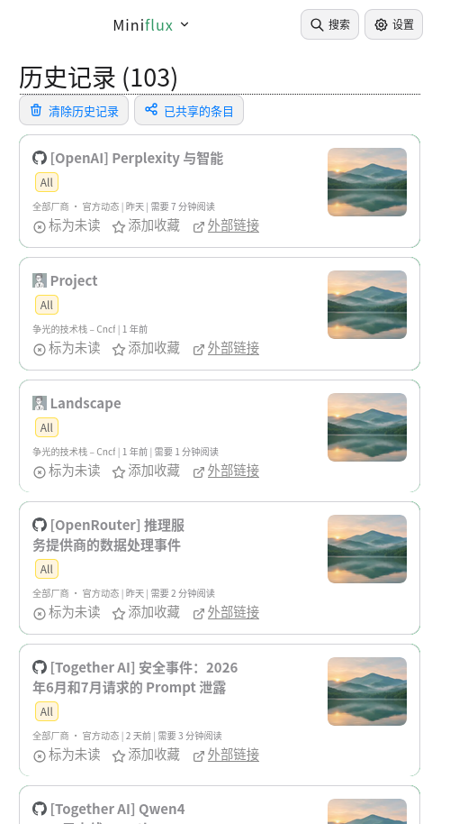
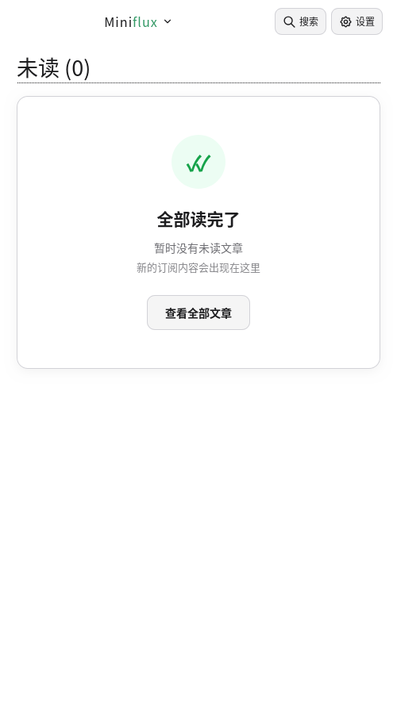
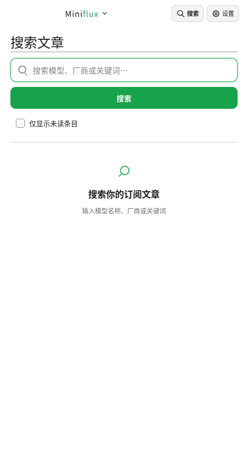

最近我给自己的 Miniflux 做了一次比较完整的主题改造：把原本偏传统的 RSS 列表，改成更适合手机阅读的微信订阅号风格。

这次改造的重点不是重新开发一个前端，而是尽可能复用 Miniflux 原有能力：不修改 Go 源码，不改数据库，不新增前端服务，只使用用户设置中的 Custom CSS 和 Custom JavaScript 做渐进增强。

最终实现了文章卡片、封面与摘要、默认风景图、左滑标记已读、空状态、移动端功能区和搜索页面优化。线上效果可以访问：<https://rss.c.daozzg.com>

## 效果截图

先看最终效果。下面三张图都来自当前线上 Miniflux 的真实移动端页面，不是设计稿。

### 文章卡片



文章列表采用左文右图结构。没有可用封面时显示本地默认风景图，顶部保留搜索和设置快捷入口。

### 未读为空



没有未读文章时，用阅读完成状态替代原来的提示框，并提供“查看全部文章”入口。

### 搜索页面



搜索框、提交按钮、未读筛选和空状态统一成当前主题风格，同时保留原生 GET 表单。

## 如何配置

这套主题针对 Miniflux 2.3.5 的实际页面结构编写。安装前建议先确认当前版本支持 Custom CSS 和 Custom JavaScript，并在测试账号中验证。

### 第一步：备份当前设置

登录 Miniflux，进入 `Settings`，分别备份：

- Custom CSS；
- Custom JavaScript；
- 当前 Theme 和 Entry Swipe 设置。

主题数据保存在用户设置中。安装和回滚都不需要修改 Miniflux 源码或数据库，但保留原配置仍然很重要。

### 第二步：选择基础主题

这套样式使用 Miniflux 的亮暗色变量，建议 Theme 选择：

```text
System Serif
```

浏览器和操作系统切换亮色或暗色后，Miniflux 与自定义主题会一起变化。

### 第三步：关闭原生 Entry Swipe

自定义主题实现的是“左滑展开按钮，再点击标记已读”。Miniflux 内置 Entry Swipe 则会在横向滑动后直接切换状态，两者会产生冲突。

因此需要在用户设置中关闭：

```text
Entry Swipe: Off
```

这一步只关闭 Miniflux 自带的直接切换手势，不会影响原生已读按钮和服务端状态保存。

### 第四步：安装 Custom CSS

将主题 CSS 粘贴到：

```text
Settings → Custom CSS
```

样式文件由两部分组成：

```text
基础主题样式
  └── 卡片、空状态、分页、导航和搜索页增量样式
```

增量样式统一使用 `wx-*` 类名，搜索页再通过 `body.wx-search-page` 限定作用范围，避免影响登录和设置页面。

如果已经安装其他第三方主题，建议先保存旧 CSS，再使用合并后的完整版本，不要反复追加多个主题，以免选择器互相覆盖。

### 第五步：安装 Custom JavaScript

将增强脚本粘贴到：

```text
Settings → Custom JavaScript
```

脚本主要负责 CSS 无法完成的部分：

- 给文章卡片增加布局类名；
- 按需提取摘要和封面；
- 安装左滑交互；
- 区分未读空状态；
- 区分尚未搜索和搜索无结果；
- 根据 Miniflux 原生分页状态生成单页提示。

脚本不会重建搜索表单，不会替换文章卡片的完整 HTML，也不会保存 API Token。

### 第六步：保存并刷新

保存设置后，重新打开下面几个页面：

```text
/unread
/history
/search
/starred
```

如果浏览器仍显示旧样式，可以关闭当前标签页后重新打开，或者清理该站点缓存。

### 第七步：检查原生功能

视觉正常还不够，至少需要验证：

- 标题和原文链接可以打开；
- 收藏和取消收藏正常；
- 标记已读后刷新页面，状态仍然正确；
- 搜索按钮和键盘回车可以提交；
- “仅显示未读条目”可以切换；
- 多页列表的上一页和下一页链接正确；
- 手机端上下滚动不会误触左滑；
- 页面没有横向溢出。

### 回滚

如果主题出现兼容问题：

1. 清空本次 Custom JavaScript；
2. 恢复之前备份的 Custom CSS；
3. 恢复原 Theme；
4. 根据需要重新启用 Entry Swipe；
5. 保存并刷新页面。

所有包装节点都只存在于当前浏览器 DOM 中，刷新后就会恢复服务端输出的原始结构。

## 详细说明

### 改造目标

Miniflux 默认界面简洁、稳定，但文章列表在手机上更接近传统文字列表。我的目标是让它具备类似微信公众号订阅号的阅读体验：

- 左侧显示标题、摘要、来源和时间；
- 右侧显示文章封面；
- 每篇文章是一张独立卡片；
- 没有封面时显示统一的默认图片；
- 支持左滑标记已读；
- 精简分页和重复操作；
- 优化未读为空和搜索无结果的状态；
- 兼容亮色、暗色和移动端；
- 保留收藏、已读、原文、搜索和键盘快捷键。

其中最重要的一条约束是：不能为了视觉效果破坏 Miniflux 原生行为。

### 先检查真实 DOM

第三方主题最容易踩的坑，是直接复制一段针对旧版本的 CSS 或 JavaScript，却没有确认当前版本的页面结构。

这次使用的是 Miniflux 2.3.5。实际检查后，文章列表的核心结构是：

```text
.items
└── article.item.entry-item[data-id]
    ├── .item-header
    │   └── .item-title a
    └── .item-meta
        └── button[data-toggle-status][data-value]
```

原生状态按钮通过 `data-toggle-status` 绑定 Miniflux 自己的事件。文章状态更新成功后，卡片会在下面两个类之间切换：

```text
item-status-unread
item-status-read
```

确认这些结构以后，主题脚本只增加包装节点和 `wx-*` 类名，不替换整张卡片的 `innerHTML`，也不移除任何原生按钮。

### 微信订阅号风格卡片

卡片布局采用左文右图结构。CSS 负责边框、圆角、阴影和响应式尺寸：

```css
.entry-item.wx-card {
  margin: 12px 0;
  padding: 18px;
  border: 1px solid var(--wx-card-border);
  border-radius: 14px;
  background: var(--wx-card-bg);
  box-shadow: 0 3px 14px rgba(0, 0, 0, 0.05);
}

.wx-content-row {
  display: flex;
  gap: 16px;
  align-items: center;
}

.wx-text {
  flex: 1;
  min-width: 0;
}

.wx-thumbnail {
  width: 112px;
  height: 88px;
  flex: 0 0 112px;
  object-fit: cover;
  border-radius: 9px;
}
```

手机端会缩小封面和间距，但继续保持左文右图。标题和摘要使用 `line-clamp` 限制为两行，避免单篇文章占用太多纵向空间。

脚本会给每张卡片写入 `data-wx-enhanced`，重复扫描时先检查这个标记，因此不会反复包装卡片或重复绑定事件。

### 从真实正文提取封面和摘要

Miniflux 的列表模板没有输出文章摘要和封面，CSS 自己也不可能从正文中提取图片。

我的处理方式是：当卡片接近视口时，使用当前登录会话读取同源文章详情页，然后从 `.entry-content` 中提取：

1. 第一张有效的 HTTP 或 HTTPS 图片；
2. 最多约 100 个字符的正文摘要。

脚本会排除带有明显极小尺寸的图片，图片加载失败时回退到默认风景图。摘要只来自真实正文，不使用标题冒充，也不会编造内容。

为了控制额外请求：

- 通过 `IntersectionObserver` 延迟加载；
- 同时最多发起 3 个详情请求；
- 使用 `sessionStorage` 缓存当前会话结果；
- 只处理当前列表页；
- 不将文章内容发送给第三方服务；
- 不在页面中保存 API Token。

默认风景图使用压缩后的本地 WebP，并以 data URI 内嵌进 CSS。这样既没有外部 CDN 依赖，也不会因为第三方占位图服务失效而留下空白。

### 左滑标记已读

移动端最实用的增强，是左滑露出“标为已读”操作：

- 左滑超过 42px，展开 96px 宽的绿色操作区；
- 右滑收起；
- 同时只允许一张卡片展开；
- 先判断手势方向，纵向滚动不会被阻止；
- 横滑结束后短暂抑制 click，避免误打开文章。

这里不能简单地在前端给卡片加一个 `item-status-read`。那样只是视觉变化，刷新页面后状态就会恢复。

自定义按钮实际触发的是 Miniflux 原生状态控件：

```text
button[data-toggle-status][data-value]
```

Miniflux 原生脚本向服务端提交成功，并更新卡片和按钮状态后，自定义操作区才会收起。这样已读状态仍由 Miniflux 保存和维护。

Miniflux 自带的 `entry_swipe` 会在左右滑动超过阈值后直接切换状态，与“展开按钮后确认”的交互冲突，因此应用这个主题时需要关闭原生滑动：

```json
{
  "entry_swipe": false
}
```

### 未读为空时的页面

默认的“没有未读条目”提示比较像系统警告。我把它改成了更轻量的阅读完成状态：

```text
        ✓✓

     全部读完了

   暂时没有未读文章
新的订阅内容会出现在这里

     [查看全部文章]
```

空状态不能只看标题中的 `(0)`。脚本会同时确认：

- 当前活动导航是未读页面；
- `#main` 中存在 Miniflux 原生空提示；
- 页面中确实没有文章卡片；
- 页面中存在原生历史记录链接。

“查看全部文章”直接复用导航中的真实地址，不猜测部署前缀，也不会把分类、搜索或错误提示误认为未读空状态。

### 精简移动端功能区

Miniflux 会在文章列表顶部和底部各输出一套分页，其中包括第一页、上一页、返回顶部、下一页和最后一页。手机屏幕上，这些重复控件占用了不少空间。

优化后的规则是：

- 隐藏顶部分页；
- 标题和“本页已读”“全部已读”尽量保持同一行；
- 空间不足时允许自然换行；
- 底部隐藏第一页、最后一页和返回顶部；
- 隐藏不可用的分页项；
- 多页时只保留真实的上一页和下一页。

只有一页时显示：

```text
──────── 已显示全部 1 篇文章 ────────
```

是否为单页，不通过当前卡片数量猜测，而是检查 Miniflux 是否输出了可用的 previous 或 next 链接。只有两个方向都不可用时，才使用当前页面的真实卡片数生成提示。

底部重复的“将本页标为已读”也没有通过隐藏整个 `.page-footer` 处理，而是只隐藏已经确认与顶部重复的原生操作节点，避免未来 Miniflux 在 footer 中增加其他功能时被误伤。

### 搜索和设置快捷入口

Miniflux 在小屏幕上会默认折叠整个主菜单，搜索和设置也会一起隐藏。为了减少常用操作的点击层级，我在菜单收起时保留了两个原生入口：

```text
Miniflux ▼             搜索    设置
```

它们仍然是服务端输出的：

```text
a[data-page="search"]
a[data-page="settings"]
```

CSS 只在菜单没有 `.js-menu-show` 时显示这两个链接。点击 Miniflux Logo 后，完整原生菜单仍会展开，其他导航逻辑不受影响。

### 搜索页面优化

搜索页面也统一成了当前主题风格。搜索输入框现在具有 48px 高度、12px 圆角、绿色聚焦边框和 CSS 绘制的搜索图标。

移动端输入字号固定为 16px，可以避免 iPhone Safari 在输入框获得焦点时自动放大页面。搜索按钮高度为 44px，并在窄屏下占满可用宽度。

原生表单没有被重建，仍然保留：

```html
<input type="search" name="q">
<input type="checkbox" name="unread" value="1">
<button type="submit">搜索</button>
```

因此键盘回车、按钮提交和“仅显示未读条目”仍然使用 Miniflux 原生 GET 表单。

搜索页会区分三种真实状态。

尚未搜索：

```text
搜索你的订阅文章
输入模型名称、厂商或关键词
```

没有结果：

```text
没有找到相关文章
尝试更换关键词后重新搜索
```

有结果时继续使用文章卡片、封面、分页、收藏和左滑操作。判断状态使用 URL 中的非空 `q`、实际结果卡片和 Miniflux 原生无结果提示，不依赖标题中的 `(0)`。

### 为什么坚持渐进增强

这次改造没有接管 Miniflux 的业务逻辑，而是尽量让 Miniflux 继续负责它擅长的事情：

- 表单提交由原生表单完成；
- 已读状态由原生状态接口保存；
- 收藏、原文和键盘快捷键保持不变；
- 分页继续使用服务端生成的真实链接；
- Custom JavaScript 只负责增加样式类、布局节点和交互外壳。

这样做的好处是升级和回滚都比较简单。遇到问题时，清空 Custom JavaScript、恢复旧 Custom CSS 并刷新页面，就能回到 Miniflux 原始界面，不需要修改数据库或重启服务。

### 性能与兼容性

主题没有引入第三方框架或在线 CDN，主要依赖现代浏览器已经普遍支持的能力：

- `IntersectionObserver`；
- `MutationObserver`；
- `:has()`；
- `touch-action`；
- `-webkit-line-clamp`；
- CSS 自定义属性和 `prefers-color-scheme`。

在不支持部分新 CSS 特性的浏览器中，核心阅读和 Miniflux 原生功能仍然存在，只是某些宽度、截断或增强布局会降级。

由于选择器基于 Miniflux 2.3.5 的实际模板，升级 Miniflux 后需要重新检查文章卡片、状态按钮、分页和搜索表单的 DOM，不能默认所有版本都完全一致。

### 实际验证

我使用真实登录页面和移动端浏览器尺寸检查了以下内容：

- 卡片、封面和摘要能够正常生成；
- 无图片文章可以回退到默认风景图；
- 已读操作提交后刷新页面仍然有效；
- 搜索和设置在菜单收起时可见，完整菜单仍可展开；
- 搜索表单能够正常进入 `/search?q=关键词`；
- 搜索结果继续拥有原生状态按钮和左滑包装；
- 单页、多页、未读为空和搜索无结果状态能够正确区分；
- 页面没有出现横向溢出。

主题优化不能只看截图。特别是已读、收藏、分页和搜索这些功能，必须确认服务器状态和真实链接没有被视觉改造破坏。

## 总结

Miniflux 的默认界面虽然朴素，但它提供了稳定、清晰而且容易渐进增强的基础。只要先检查真实 DOM，尊重原生表单、状态控件和分页链接，就可以通过一套用户级 CSS 和 JavaScript，把它改造成更符合个人阅读习惯的移动端 RSS 应用。

对我来说，这次改造最有价值的并不是某一段 CSS，而是确认了一条可维护的路线：视觉层可以大胆优化，业务状态尽量交还给 Miniflux，所有增强都应该能随时关闭和回滚。
